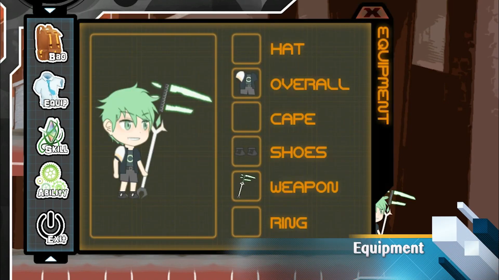
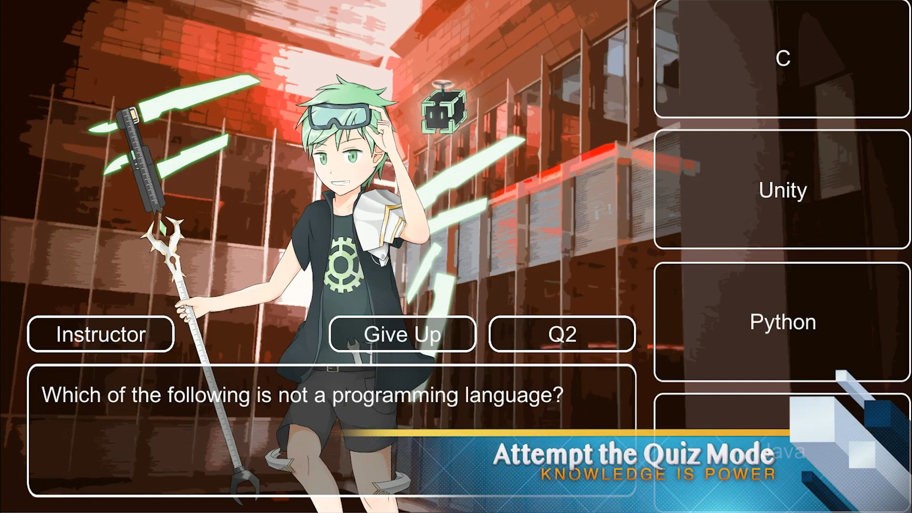
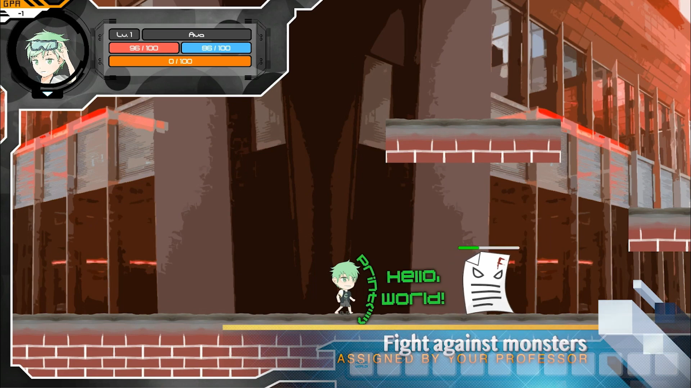

# Road to Graduation

A Unity game developed as a university group project for a gamification course, exploring how game mechanics can make the learning experience more engaging.

## Overview

Road to Graduation is a game designed around the university learning journey. It uses gameplay systems and progression mechanics to make the experience of learning more interactive and enjoyable.

## My Contributions

As an Engineer on the team, I worked on the implementation of several gameplay systems:

- **AI-controlled Enemies:** Implemented monster behaviours, including automatic pathfinding.
- **Inventory System:** Developed the inventory functionality for managing collected items.
- **Equipment System:** Implemented equipment-related gameplay functionality.
- **Shop System:** Developed the in-game shop system.
- **Combat and Character Progression:** Implemented combat skills and upgradeable player attributes, including defence and movement speed.

## Technologies

- Unity 2017.3.0f3
- C#

## Project Type

University group project — Gamification Course.

## Screenshots

## Status

Completed university project.
